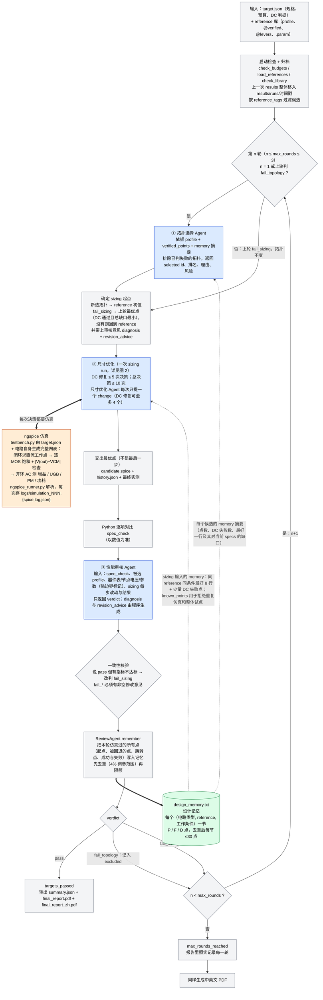
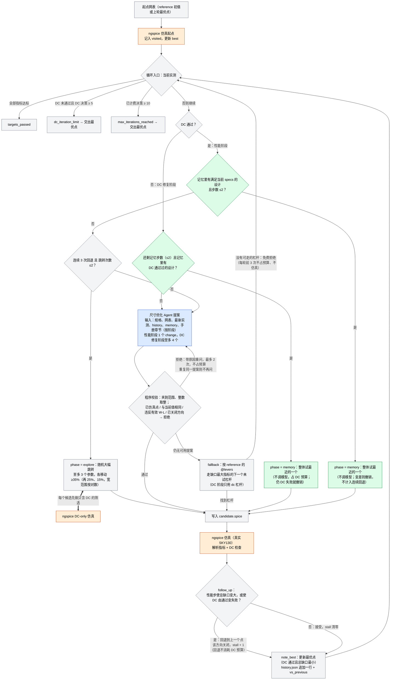

# 三 Agent 运放设计流程（SKY130）：拓扑选择 → 尺寸优化 → 性能审核

[English README](README_EN.md)

给定规格（`circuits/opamp/specs/target.json`）和一个 reference 电路库（`circuits/opamp/reference/`，共 6 种运放结构），
由三个互相独立、与具体电路无关的 Agent 协作，用真实 ngspice 仿真闭环完成设计，最后生成中英文 PDF 报告。

## 三个 Agent 与流程

| Agent | 目录 | 职责 | 输入（每项只出现一次） |
|---|---|---|---|
| 拓扑选择 | `agents/topology_agent/` | 按规格从候选结构中选一个 | 指标、testbench 说明、各 reference 的 **profile**（优缺点描述）；返工时还有此前各轮摘要与审核意见 |
| 尺寸优化 | `agents/sizing_agent/` | 只改被选中电路的可调 `.param`，先 DC 后性能 | 指标与预算、当前网表（含该电路的专用说明）、最新实测（合并后的器件表、节点电压）、预计算数值、本次迭代历史、全局公式手册；返工时还有审核意见 |
| 性能审核 | `agents/review_agent/` | 判断是否达标；不达标则判定是拓扑问题还是尺寸问题，并写修改意见 | Python 逐项指标对比、被选 profile、最终器件表/节点电压/参数（含贴边界标记）、sizing 每一步的改动与结果、日志中无法由结构化数据表达的部分 |

整个流程**只有这三个 Agent**，没有“每个 reference 一个专用 sizing agent”。三个 Agent 的 prompt、代码、公式手册里**没有任何具体电路的信息**
（器件名、参数名、拓扑名）；唯一含具体拓扑信息的地方是 `circuits/opamp/reference/*.spice`（`tests/test_references.py` 用正则强制检查这一点）。

### 图 1：整体流程（轮次、返工路由、设计记忆、ngspice）

图中：蓝色 = Agent（调用模型）；橙色 = ngspice 仿真；绿色 = 设计记忆 `design_memory.txt`；虚线 = 数据读取，实线 = 控制流。



### 图 2：一次 sizing run 的内部（贪心爬山 + 程序兜底 + 设计记忆 + ngspice）

图中橙色节点 = 每次都调用 ngspice；蓝色 = 调用模型；绿色 = 使用设计记忆。



**每一轮按顺序发生的事**

1. **选拓扑**（第 1 轮，或上轮 `fail_topology`）：拓扑 Agent 读 profile、`verified_points`（程序已与当前 specs 比较）和 memory 摘要，选一个 reference。
2. **确定起点**：新拓扑从 reference 初值开始；`fail_sizing` 则从上轮最优点开始并带审核意见。
3. **sizing**：先 ngspice 仿真起点；DC 不通过就修复（最多 5 次决策），通过后做性能优化（总决策最多 10 次）。每一步都由真实 ngspice 验证，模型只提一个参数改动，其余确定性动作（夹范围、拒绝重复、回退、fallback、跳转、记忆整体试点）由程序完成。
4. **审核**：程序先逐项对比数值，再由审核 Agent 给 `verdict`；数值与结论矛盾时以数值为准。
5. **写记忆**：无论通过与否，本轮仿真过的所有点都写入 `design_memory.txt`，供之后的拓扑选择、sizing 起点修复和整体试点使用（也供下一次运行使用）。
6. **路由**：`pass` 结束；`fail_topology` 把该拓扑排除后重选；`fail_sizing` 沿用拓扑继续；3 轮后仍未通过则 `max_rounds_reached`。

- **整体流程最多 3 轮**（`target.json → budgets.max_rounds`，要求 1…3）。一轮 = （需要时）选拓扑 → 一次完整 sizing → 审核。
- **每次 sizing** 仍遵循原来的次数：先 DC，DC 修复累计最多 5 次（`max_dc_iterations`）；DC 通过后做性能优化，该次 sizing 总决策最多 10 次（`max_iterations`）。
  两种预算相互独立：流程 3 轮，每轮的 sizing 都可以用满 10 次，所以整个流程里 sizing 决策可以超过 3 次（最多 30 次）。
- 第 1 轮必选拓扑。之后：审核判 `fail_topology` → 下一轮重新选拓扑（已被判失败的拓扑不再提供），sizing 从新 reference 的初始值开始；
  审核判 `fail_sizing` → 下一轮拓扑不变，sizing 带着审核意见继续（从上一轮找到的**最优点**继续——DC 通过且对各指标总缺口最小的点，而不是上一轮停下的位置；上一轮没有任何 DC 通过的点则从 reference 重来）。
- 审核结论以 Python 的逐项数值对比为准：审核 Agent 若说 `pass` 但有指标不达标，会被改判 `fail_sizing` 并在 `review.json` 记录；
  审核 Agent 若判 `fail_*`，必须给出非空的修改意见。
- 三轮结束仍未通过则 `max_rounds_reached`，报告里照实记录每一轮。

## 一行命令：选择模型

用 `SIZING_MODEL` 选模型（或给脚本加 `--model`），**必须指定**，否则程序拒绝启动。三个 Agent 使用同一个模型，但各有独立的客户端，token 与调用分别记录。

| 模型名 | 后端 | 实际模型 ID | 备注 |
|---|---|---|---|
| `qwen` | 本地 GPU | Qwen3-8B | 自动选空闲 GPU、启动服务、结束后关闭；上下文仅 32k |
| `fable` | Claude Code | claude-fable-5-1 | |
| `sonnet` | Claude Code | claude-sonnet-5-5 | |
| `opus` | Claude Code | claude-opus-5-5 | |
| `astra` | Codex | gpt-6-astra | |
| `sol` | Codex | gpt-6-sol | |
| `luna` | Codex | gpt-6-luna | |

```bash
cd /home/xu/Multi-agent

SIZING_MODEL=sonnet bash scripts/run_all.sh        # 完整三 Agent 流程
bash scripts/run_all.sh --model sol                # 等价写法

# 不调用任何模型：只仿真某一个 reference 的初始网表并出报告（检查 reference 能否被工具链读懂）
bash scripts/run_all.sh --baseline-only --reference two_stage_nmos_input_pmos_stage2
```

- 也可以直接写完整模型 ID：`SIZING_MODEL=gpt-6-sol`、`SIZING_MODEL=claude-opus-5-5`；旧的 `SIZING_BACKEND=qwen|claude|codex` 仍可用（选该后端默认模型）。
- Claude 模型通过 Claude Code CLI 调用（本机已登录账号）；Codex 模型通过 `codex exec` 调用（`~/.codex/auth.json`），不读 `config.toml`，不保存会话。找不到 CLI 时用 `CLAUDE_BIN` / `CODEX_BIN` 指定。
- 某个模型账号额度用完会直接报错，换一个模型名重跑即可。
- 已运行的本地 Qwen 服务（`scripts/start.sh`）可用 `SIZING_MODEL=qwen bash scripts/run_demo.sh` 复用，`stop.sh` 关闭。

## reference 库（唯一含具体拓扑信息的地方）

`circuits/opamp/reference/` 每个文件是一种候选结构，文件名即 id，统一为“结构_输入管极性[_第二级]”：

| 文件（id） | 结构 |
|---|---|
| `two_stage_nmos_input_pmos_stage2` | 两级 Miller 运放，NMOS 输入，PMOS 共源第二级（**已验证**：已有两组设计分别达到 UGB 22 MHz 和 99 MHz） |
| `two_stage_pmos_input_nmos_stage2` | 两级 Miller 运放，PMOS 输入，NMOS 共源第二级（未验证；VCM=0.9 V 下输入对需 L_IN≈0.15 µm） |
| `folded_cascode_nmos_input` | 折叠式共源共栅，NMOS 输入（已有一个 DC/AC 有效点：增益 57.7 dB、UGB 51.6 MHz、PM 76.9°；尚未达到 80 MHz） |
| `folded_cascode_pmos_input` | 折叠式共源共栅，PMOS 输入（未验证） |
| `telescopic_cascode_nmos_input` | 套筒式共源共栅，NMOS 输入（未验证） |
| `telescopic_cascode_pmos_input` | 套筒式共源共栅，PMOS 输入（未验证） |

reference 里**只有被测电路本身**，从上到下依次是：

1. **`@profile-begin … @profile-end`**：结构、优点、缺点、适用/不适用场景、验证状态（含基线仿真观察）。拓扑选择 Agent 只能依据这段文字做选择，审核 Agent 也读它。
2. **`@analyses-begin … @analyses-end`**（可选）：JSON 列表，声明该结构适用的预计算类型（电流平衡比、补偿零极点、cascode 堆栈输出电阻与增益估计），器件名只在这里出现。
3. **`* @feedback-input: vinp|vinn`**：单位负反馈接回哪个输入端，即该电路的反相输入。输出随 `vinp` 升高而下降的（两级运放）写 `vinp`，上升的（折叠/套筒式单级运放）写 `vinn`。
   这是拓扑属性，必须在求直流工作点之前就知道，所以放在 reference 里；写错了会在 AC 里被发现（环路增益低频为负，仿真判无效，并提示接错反馈端）。
4. **NOTES 注释**：该电路专用的 DC 平衡关系、偏置关系、标定数据（sizing Agent 读）。
5. **`.param` 与电路**。可调参数就是带 `; tune 下限..上限 [单位] [int]` 注解的 `.param` 行（例：`.param W_IN=10 ; tune 1..100 um`，`int` 表示整数），其余 `.param` 为固定常数。
   器件端点、模型、W/L 表达式、DC 检查要用的诊断名都**直接从网表解析**，不再另写一遍。

**不在 reference 里的东西**（重复输入已删除）：供电/输入源/反馈环路/AC 源/负载电容、`.lib`/`.temp`、DC 诊断 `print`、AC 分析与测量都由共享 testbench（`simulator/testbench.py`）
按 `target.json` 和电路自己的器件/节点生成，所以所有拓扑用完全相同的方式测量，改条件只改 `target.json` 一处。

**闭环偏置、开环测量**（testbench 的核心约定）：
- 直流工作点在单位负反馈闭合时求得：`out` 经一个很大的电感（直流短路）接回反馈输入端，另一个输入端固定在 VCM，所以输出像实际使用时一样停在 VCM，
  而不是被开环下的微小失配放大后推向电源轨。DC 检查（每个 MOS 饱和）就在这个真实工作点上做，并要求 `|V(out)−VCM| ≤ maximum_output_error_v`（`target.json`），
  否则说明环路没有稳住输出（接错反馈端、某级饱和或整条支路没电流）。
- AC 测的是开环：这个电感对交流开路，在反馈输入端经一个隔直电容注入 1 V AC，环路增益 T=−V(out)/V(注入)，负反馈时低频为正。
  增益、UGB、PM 都由 T 得到；T 低频不为正（接错反馈端或增益为零）则整次仿真判无效。
- 两级运放的级间电流失配 Rm 不再把输出推到轨：闭环把它吸收为输入失调，所以两级运放的基线直接通过 DC，DC 修复主要出现在偏置电压多的单级 cascode 和 PMOS 输入结构上。
reference 必须用端口节点 `vdd`、`vinp`、`vinn`、`out`，且不得含 `.lib/.temp/.control/.end/.nodeset/.ic`、`VSUPPLY/VINP/VINN/CLOAD_OUT/LFB/VAC/CAC`、节点 `acin` 与参数 `VDD/VCM/CLOAD`（加载时检查，违反即拒绝启动）。
加载时还检查：每行一个 `.param`；初值在可调范围内；整数参数的初值是整数；每个可调参数都被电路用到；`@analyses` 里的器件都存在。
有效 W/L（含 `N_TAIL*WBN0` 这类乘积）的上下限是工艺规则，放在 `target.json → device_limits`，对所有 MOS 生效。

**新增一个拓扑**：复制一个 reference，改电路、profile、注解和 NOTES，文件名按上面的规则取；不需要改任何其他文件，`pytest` 会检查它。
`target.json` 只放规格：工艺/条件、指标、器件尺寸限制、DC 判据阈值（含输出须稳在 VCM 的窗口）、AC 扫描、预算。

## 每次调用 Agent 看到什么

只有尺寸优化 Agent 每次调用都会读取 `ANALOG_DESIGN_RULES.md`（与电路无关的公式、判据和通用诊断自检；哈希记入调用记录）。
同一个事实只出现一次：

- **器件表**：每个 MOS 一行，合并了工作点（极性归一化的 |Vgs|、|Vds|、|Vth|、|Vdsat|）、过驱动/饱和裕量、gm、gm/Id、gm/gds、W/L 和失败的 DC 判据；不再另给“原始诊断 + DC 验收明细 + 预计算”三份。
- **参数**：值、范围、整数标记都在带注解的 `.param` 行上，不另给参数表/当前值/边界表。
- **日志**：数值行、横幅、已进结构化字段的错误/警告都不重复，只给其余行（通常为空）。
- **历史**：每次决策的改动与实测结果；不含模型此前的说明文字；最后一条的结果就是当前实测，不重复。
- **Testbench**：由代码生成的一段说明（条件与指标定义），与实际仿真网表同源。
- 拓扑选择与审核 Agent 不接收公式手册。

输出：拓扑选择 Agent 返回选中 id、每个候选的适配度与理由、预期风险；
尺寸优化 Agent 先返回**一个** `change`（`parameter` 为可调参数名枚举，只给 `new_value`；old_value 由程序按当前网表填写），再返回简短 `analysis`。程序在模型外做这些确定性处理（`analog_agents/search.py`、`agents/sizing_agent/loop.py`）：
- 超出范围的值夹到范围边界、整数四舍五入；
- 已仿真过的点（含曾使 DC 失败的点）、与当前值相同的提案、违反有效 W/L 范围的提案被拒绝，并把原因告诉模型重新回答（同一决策内最多再问 2 次，不占决策预算；最终仍不合格才记录并占一次决策）；
- 性能阶段某一步若使各指标的总缺口变大（含使 DC 由通过变失败），自动回退到上一个点（贪心爬山，模型永远在当前最优点上改）；该步所在方向在“没有任何改善”之前不能再提（`history` 的 `vs_previous` 列给出每步好/坏），回退不消耗 DC 修复预算；
- **DC 修复阶段**：(1) 起点 DC 失败时，先把 memory 里离起点最近的、DC 通过过的设计整体试一次（不要求满足 specs，最多 2 个，占 DC 修复预算；仍然失败就撤销）；(2) 一次决策最多可改 4 个参数（偏置电压相互耦合，单独改一个往往没有任何变化；性能阶段仍是 1 个）；(3) reference 的 `@levers` 里可以有 `"dc"` 键，列出能让“关断”电路导通的参数（`-` 降低、`+` 升高，最有效的在前），回退步在 DC 阶段只用这些杠杆，一次同时走前 2 个；(4) 当所有 MOS 的 DC 都失败（电路没有电流）且 reference 声明了 `dc` 杠杆时，只改尺寸的提案会被拒绝并提示先动偏置杠杆。
- **重问不再空转**：模型重复一个已被拒绝的提案就不再问第 3 次；拒绝信息带 `try_instead`（还没试过、也没被禁的杠杆）。仍然没有可用提案时，由程序走一步“回退杠杆”（`fallback`）：reference 的 `@levers`（`{"指标": {"参数": "+"|"-"}}`，`+` 表示调高该参数会使该指标升高）里，缺口最大的指标的下一个未试杠杆，按固定步长（宽范围 ×1.5，整数 ±1，窄范围 ±20% 范围）走一步；reference 没声明杠杆时，走一个从未动过的参数。找不到可走的杠杆才算免费拒绝。
- **memory 里满足当前 specs 的设计整体试一次**：从 memory 里找出对**当前** specs 全部满足的设计，按离起点的距离从近到远，每轮最多试 2 个，作为一次决策（`phase: memory`，所有不同的参数一起改，不调模型）。没验证（实测变差）就撤销，这一步不计入连续回退。memory 里的点还用来拒绝重复仿真，并按当前 specs 重新标 `P/F`。
- 大幅跳转的随机种子随轮数变化，一次只动至多 2 个参数，且不会落在已记住的点上。
- **连续 3 次回退（都没改善）就放弃爬山**：由程序（不调用模型）随机大幅改动至多 3 个参数（各至少移动调参范围的 35%，不行再降到 25%、15%；宽范围按对数刻度），每个候选先做一次只含 DC 的仿真筛选，通过的才作为新区域的起点（`phase: explore`，`vs_previous: jump`），之后模型在新区域里继续单步微调。每轮 sizing 最多跳 2 次；找不到 DC 合格的跳点时占一次决策并继续原来的爬山。整个过程的最优点最后交出。
- 一次决策的所有尝试都被拒绝时，每轮前 3 次不占决策预算，也不重新仿真（`budgets.cost_free_refusals_left`）；
- 输入里的 `history` 是“已仿真点”表（变化过的参数、DC 状态、各指标），不再带模型自己的文字；
- 一轮结束时交出最优点，而不是最后一步；
- 手册按阶段只发相关章节（DC 修复阶段 1/3/4/6/12/14，性能阶段另加 8/9/13）。

审核 Agent 只返回 `verdict`；`diagnosis` 和给出错一方的 `revision_advice` 都由程序根据 `spec_check`、贴边界的参数（标明只能增/减）、上一轮从未动过的参数、预算状态生成——模型引用数字不可靠。

**设计记忆（`design_memory.txt`）**：每轮结束后，review agent 把这一轮仿真过的所有点（成功和失败，含起点、被回退的点、跳转点）写进项目根目录的这个文件（`ReviewAgent.remember` → `analog_agents/memory.py`）。
- 每个 (电路类型, reference, 工作条件) 一节；每行一个点：`P 74.6 22.1 63.3 106 | W_STAGE2=23 R_RZ=7k`。状态 `P` = 满足当时 specs，`F` = 仿真了但没满足，`D` = DC 门失败（无性能，不写 `-`）；性能按 `cols` 行的顺序，单位写在方括号里（UGB 用 MHz、功耗用 uW）；`|` 之后只写与 reference 起点不同的参数，数值用最短的 SPICE 写法（`7k`、`1.5p`）。
- 写入时先去重再限额：同一 reference 下，所有参数都在调参范围的 4% 以内的点只留一个（保留更好的，打平留更新的；DC 失败点与非 DC 失败点分开比较），然后每节最多 30 个点（其中 DC 失败点最多 10 个，保留最新的）。
- 读取：拓扑 agent 的每个候选带 `memory`（点数、DC 失败数、最好的一行及它对当前 specs 的缺口，由程序计算）；sizing agent 的输入带 `memory`（同一 reference、同一工作条件下最好的 8 行，含对**当前** specs 的缺口 `mX`，再加几个 DC 失败点）。只作为证据，不是答案。
- `python scripts/build_memory.py` 从 `results/runs/*`、当前 `results/`、reference 的 `@verified`（含 `params`）和 reference 备注里记载的点重建该文件（不调模型、不仿真；只用闭环测试台之后的记录，旧的开环记录不可比，跳过）。

- `specs/target.json` 里可选的 `reference_tags`：只有在 reference 里用 `* @tags: …` 声明了其中任一标签的结构才会提供给拓扑 Agent（删掉这一行即恢复全部候选；目前四个 cascode 结构带 `cascode` 标签）。

**已验证点（`@verified`）**：reference 里可以加一个机器可读的 `* @verified-begin … * @verified-end` 块（JSON 列表，每项 `{"conditions": {"vdd_v":…, "load_capacitance_f":…}, "metrics": {…}}`，必须是真正仿真过的设计）。拓扑 Agent 的每个候选带 `verified_points`，由程序与当前 specs 比较给出 `meets_specs`（true / false / 条件不同则为 null）和 `shortfalls`；prompt 禁止模型自己拿 profile 文本里的数字去比。sizing Agent 看不到该块。

## 输出

`circuits/opamp/results/`（每次运行前，上一次的结果整体**移入** `results/runs/<时间戳>/`）：

```
summary.json              流程状态、轮数、各 Agent 的调用数与 token、仿真数、耗时、模型、每轮摘要、最终网表路径
specs.json                本次运行用的规格
round_01/ round_02/ …     每轮一个目录
    topology_selection.json  本轮选拓扑的结果（排名、理由、风险）；沿用拓扑的轮次没有此文件
    topology_calls.json      拓扑 Agent 的调用记录
    candidate.spice          本轮的电路（sizing 过程中就地修改，结束时即最终网表）
    history.json             每次决策：分析、改动、是否接受、实测结果（第一条含起点 before）
    sizing_calls.json        尺寸优化 Agent 的调用记录（token、规则哈希、原始响应）
    summary.json             本轮 sizing 汇总（含 reference 初值）
    review.json / review_calls.json   审核结论、诊断、修改意见
    logs/simulation_NNN.{spice,log,json}   每次仿真的完整网表、日志、解析记录
final_report.pdf          英文报告
final_report_zh.pdf       中文报告
```

PDF 报告先给最终结果、规格对比、各轮总表和统计，然后按 Agent 实际的工作顺序逐轮展开：每一轮依次是
步骤 1 拓扑选择（理由与排名）→ 被选电路（profile、电路图、连线表）→ 步骤 2 尺寸优化（逐次迭代、DC 验收、参数初值/终值）→ 步骤 3 审核结论与修改意见；
最后是完整 DC 诊断与最终网表。每个被选中参与 sizing 的拓扑在它第一次出现的那一轮画出电路图（再次沿用时指回该轮）。模型生成的文字保留英文原文。
（电路图由网表自动绘制，与拓扑无关：MOS 与两端元件（电阻、电容、电流源、电压源）按到 vdd 的沟道距离分行，沿堆叠对齐成列，所有连线用黑色正交走线连起来、交汇处画圆点，vdd 和地用符号表示，接地的理想偏置电压源画成带名字的偏置端点，画法接近教科书。）

## 文件说明

| 路径 | 作用 |
|---|---|
| `main.py` | 三 Agent 流程编排：轮次、返工路由、结果落盘、报告 |
| `agents/topology_agent/` | 拓扑选择 Agent（prompt、候选枚举与选择校验） |
| `agents/sizing_agent/` | 尺寸优化 Agent（prompt、提案校验与应用、输入构造；`loop.py` 为单次 sizing 循环） |
| `agents/review_agent/` | 性能审核 Agent（prompt、指标对比、输入构造、判定一致性校验） |
| `analog_agents/reference.py` | reference 库加载与检查，由网表合成 sizing 用的 target |
| `analog_agents/spice.py` | SPICE 文本工具：数值、`.param`、MOS 实例、节点、受限表达式 |
| `analog_agents/evidence.py` | 给 Agent 的实测视图（器件表、节点电压、日志去重） |
| `analog_agents/analog_calc.py` | 公式库与 `derive()`（预计算数值，按 reference 的 `@analyses` 启用） |
| `analog_agents/models.py`、`factory.py`、`client.py`、`rules.py`、`schema.py`、`config.py` | 模型注册表；每个 Agent 的客户端；Qwen/Claude/Codex 适配；公式手册注入；JSON schema 工具；本地服务配置 |
| `simulator/testbench.py` | 共享 testbench：生成完整仿真网表、描述 |
| `simulator/ngspice_runner.py` | ngspice 运行与解析、DC 检查 |
| `simulator/report_generator.py` | 中英文 PDF 报告（拓扑无关） |
| `circuits/opamp/` | `reference/`（拓扑库）、`specs/target.json`（规格）、`results/`（运行结果，已 gitignore） |
| `ANALOG_DESIGN_RULES.md` | 通用模拟电路公式与诊断规则（与拓扑无关） |
| `tools_path.md` | ngspice 与 SKY130 库路径 |
| `scripts/` | 一行入口 `run_all.sh`、复用已启动 Qwen 服务的 `run_demo.sh`、本地 Qwen 服务的安装/启停 |

## 修改规则或电路说明

- 与电路无关的公式、判据、通用建议 → `ANALOG_DESIGN_RULES.md`。
- 某个拓扑的优缺点、适用场景 → 该 reference 的 `@profile` 段；与该拓扑相关的数值、方向、标定数据 → 其 NOTES；
  可调参数及范围 → 其 `.param` 注解；预计算类型 → 其 `@analyses`。
- 工作条件、指标、预算、器件尺寸限制、AC 扫描 → `target.json`；测量定义 → `simulator/testbench.py`。

## 测试

```bash
/home/xu/.venv/bin/python -m pytest -q             # 默认：不调用模型，不需要 GPU，不跑 PDK，几秒内完成
/home/xu/.venv/bin/python -m pytest -q -m pdk      # 另跑 9 个真实 SKY130 + ngspice 的测试（约 2.5 分钟）
```

包括：每个 reference 自洽性与命名规范、“具体电路信息只出现在 reference 中”的正则检查、恰好三个 Agent 的检查、
testbench 生成（所有 reference 同一套测量、条件只来自规格）、证据视图去重，
以及用脚本化 Agent 与脚本化仿真器测试整个流程的路由（首轮通过、sizing 返工、拓扑返工并排除失败拓扑、3 轮上限、预算校验、审核结论被数值覆盖、从头/续做、旧结果归档）。

`-m pdk` 的 9 个测试用真实 PDK 检查：基线两级运放在闭环下 DC 通过且输出被钳在 VCM、profile 里记录的两个已验证设计、
把反馈接到另一个输入时环路增益为负（被判无效）、折叠式 NMOS 输入的已验证偏置点在 `vinn` 上相位裕度合理（不是接反时的 256°），
以及其余四个 reference 在声明的反馈输入上低频环路增益为正、接到另一个输入上为负（六个声明合起来全部覆盖）。
它们不属于默认测试，因为每个设计约 15 秒；改动 testbench、反馈声明或 reference 里引用的已验证数据后应该跑一遍。

## 已知限制

- 除 `two_stage_nmos_input_pmos_stage2` 外，其余 5 个 reference 的初始尺寸/偏置是示意性的，基线都不能通过 DC 检查（profile 里已写明原因）。
  折叠/套筒式使用理想偏置电压源，参数多且耦合强，5 次 DC 修复内能否通过取决于模型；这正是审核 Agent 判 `fail_topology/fail_sizing` 的依据。
  PMOS 输入的三个 reference 在 VCM=0.9 V 下还受 PDK 限制：pfet_01v8 的 |Vth| 随 L 变化很大（0.15 µm 约 0.68 V，0.5 µm 约 1.02 V），输入对必须用最短的 L。
- `@feedback-input` 由写 reference 的人声明。六个声明都做过 ngspice 检查：接对时低频环路增益为正；接反时为负，或输出锁死在电源轨。检查结果也与手工推导的信号电流方向一致。
  两级的两个和套筒式的两个测的是基线（PMOS 输入两级和两个套筒式的基线仍未通过 DC，但环路已稳住或有增益，符号有意义）；折叠式 NMOS 输入用已验证的偏置点；
  折叠式 PMOS 输入的基线是死电路，用的是 ngspice 搜索到的、闭环稳在 VCM 的弱反型偏置点（那里只有过驱动判据不过）。这些实验只用了 ngspice，没有跑 Agent 流程。
- reference 不再是可以直接交给 ngspice 的完整网表（testbench 由工具生成）。想看某次实际仿真的完整网表，打开 `round_NN/logs/simulation_NNN.spice`。
