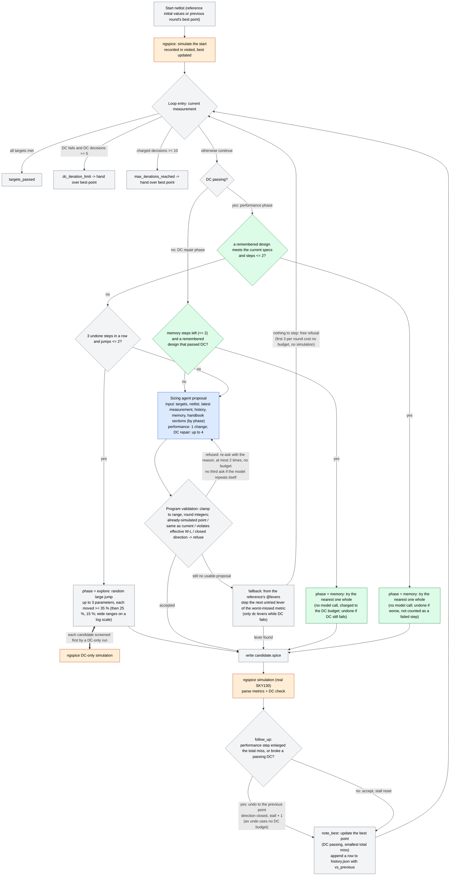

# Three-Agent Op-Amp Design Flow (SKY130): Topology Selection -> Sizing -> Performance Review

[中文 README](README.md)

Given specifications (`circuits/opamp/specs/target.json`) and a library of reference circuits
(`circuits/opamp/reference/`, six op-amp structures), three independent, circuit-agnostic agents
cooperate in a closed loop with real ngspice simulation and finally produce English and Chinese PDF reports.

## The three agents and the flow

| Agent | Directory | Job | Inputs (each item appears once) |
|---|---|---|---|
| Topology selection | `agents/topology_agent/` | Pick one structure for the specs | Targets, testbench description, each reference's **profile** (pros/cons text); on a retry also earlier rounds and the reviewer's advice |
| Sizing | `agents/sizing_agent/` | Edit only the tunable `.param` values of the selected circuit: DC first, then performance | Targets and budgets, the current netlist (with the circuit's own notes), the latest measurement (one merged device table, node voltages), pre-computed numbers, this run's history, the global formula handbook; on a retry also the reviewer's advice |
| Performance review | `agents/review_agent/` | Decide pass/fail; on failure decide whether the TOPOLOGY or the SIZING is at fault and write revision advice | Python's per-metric comparison, the selected profile, final device table / node voltages / parameters (bound usage flagged), every sizing step with its result, the parts of the log that the structured data cannot express |

There are **exactly three agents**; there is no per-reference sizing agent. The prompts, code and formula handbook
contain **no circuit-specific information** (no device names, parameter names or topology names). The only place that
holds topology information is `circuits/opamp/reference/*.spice` (`tests/test_references.py` enforces this with a regex scan).

### Figure 1: overall flow (rounds, retry routing, design memory, ngspice)

Blue = agent (model call); orange = ngspice simulation; green = design memory `design_memory.txt`; dotted = data read, solid = control flow.

```mermaid
flowchart TD
    classDef agent fill:#dbeafe,stroke:#1d4ed8,color:#000
    classDef sim fill:#ffedd5,stroke:#c2410c,color:#000
    classDef mem fill:#dcfce7,stroke:#15803d,color:#000
    classDef code fill:#f3f4f6,stroke:#6b7280,color:#000

    IN["Inputs: target.json (targets, budgets, DC criteria)<br/>+ reference library (profile, @verified, @levers, .param)"]:::code
    START["Start-up checks + archive<br/>check_budgets / load_references / check_library<br/>previous results moved to results/runs/timestamp<br/>candidates filtered by reference_tags"]:::code
    MEM[("design_memory.txt<br/>design memory<br/>one section per (circuit type, reference, condition)<br/>P / F / D points, de-duplicated, <= 30 per section")]:::mem

    IN --> START --> ROUND

    ROUND{"Round n (n <= max_rounds <= 3)<br/>n = 1 or previous verdict fail_topology ?"}:::code
    ROUND -- "yes" --> TOPO
    ROUND -- "no: previous fail_sizing, topology kept" --> SIZSTART

    MEM -. "per-candidate memory summary<br/>(points, DC failures, best row and its miss of the current specs)" .-> TOPO
    TOPO["1. Topology agent<br/>from profiles + verified_points + memory summary<br/>excludes topologies already rejected; returns selected id, ranking, reasons, risks"]:::agent
    TOPO --> SIZSTART

    SIZSTART["Choose the sizing start<br/>new topology -> reference initial values<br/>fail_sizing -> previous round's best point (DC passing, smallest total miss), else the reference<br/>plus the reviewer's diagnosis + revision_advice"]:::code
    MEM -. "sizing input memory: 8 best rows for the same reference and conditions<br/>+ a few DC failures; known_points refuse repeated simulations and are tried whole" .-> SIZ
    SIZSTART --> SIZ

    SIZ["2. Sizing run (details in Figure 2)<br/>DC repair <= 5 decisions; total <= 10 decisions<br/>the sizing agent proposes ONE change per decision (up to 4 during DC repair)"]:::agent
    SIZ <== "every decision is simulated" ==> NG
    NG["ngspice simulation<br/>testbench.py builds the full deck from target.json + the circuit itself:<br/>closed-loop DC operating point -> every-MOS saturation + |V(out)-VCM| check<br/>-> open-loop AC for gain / UGB / PM / power<br/>ngspice_runner.py parses; each run stored as logs/simulation_NNN.{spice,log,json}"]:::sim

    SIZ --> OUT["Hand over the BEST point (not the last step)<br/>candidate.spice + history.json + final measurement"]:::code
    OUT --> CHECK["Python per-metric comparison spec_check<br/>(the numbers are authoritative)"]:::code
    CHECK --> REV["3. Review agent<br/>inputs: spec_check, selected profile, device table / node voltages / parameters (bound usage flagged), every sizing step<br/>returns only the verdict; diagnosis and revision_advice are generated by the program"]:::agent
    REV --> RULE{"Consistency check<br/>pass with a failing metric -> changed to fail_sizing<br/>fail_* must carry non-empty advice"}:::code

    RULE --> REMEMBER["ReviewAgent.remember<br/>writes every point this round simulated<br/>(start, undone steps, jumps, successes and failures) to memory<br/>de-duplicated (4 % of tune range) then capped"]:::code
    REMEMBER ==> MEM

    REMEMBER --> V{"verdict"}:::code
    V -- "pass" --> DONE["targets_passed<br/>write summary.json + final_report.pdf + final_report_zh.pdf"]:::code
    V -- "fail_topology: added to excluded" --> LIMIT
    V -- "fail_sizing" --> LIMIT
    LIMIT{"n < max_rounds ?"}:::code
    LIMIT -- "yes: n+1" --> ROUND
    LIMIT -- "no" --> MAXR["max_rounds_reached<br/>the report records every round as it happened"]:::code
    MAXR --> PDF["PDFs are written as well"]:::code
```



### Figure 2: inside one sizing run (greedy climb + program-side fallbacks + design memory + ngspice)

Orange nodes call ngspice every time; blue nodes call the model; green nodes use the design memory.



**What happens in one round, in order**

1. **Topology selection** (round 1, or after `fail_topology`): the topology agent reads the profiles, `verified_points` (already compared with the current specs by the program) and the memory summary, and picks one reference.
2. **Start point**: a new topology starts from the reference's initial values; after `fail_sizing` sizing starts from the previous round's best point together with the reviewer's advice.
3. **Sizing**: ngspice simulates the start; if DC fails, repair it (at most 5 decisions); once DC passes, optimise performance (at most 10 decisions in total). Every step is verified by real ngspice; the model proposes one parameter change and the program does everything deterministic (clamping, refusing repeats, undo, fallback, jumps, trying remembered designs whole).
4. **Review**: the program compares the numbers per metric, then the review agent gives the `verdict`; when the numbers contradict the verdict the numbers win.
5. **Write memory**: pass or fail, every point simulated this round is written to `design_memory.txt`, for later topology selection, DC repair and whole-design trials (and for the next run).
6. **Routing**: `pass` ends; `fail_topology` excludes that topology and reselects; `fail_sizing` keeps the topology and continues; after 3 rounds without a pass the status is `max_rounds_reached`.

- **At most 3 rounds** overall (`target.json -> budgets.max_rounds`, must be 1..3). One round = (if needed) select a topology -> one complete sizing run -> review.
- **Each sizing run** keeps the original budgets: DC repair at most 5 decisions in total (`max_dc_iterations`); after DC passes, performance
  optimisation up to 10 decisions in total for that run (`max_iterations`). The two budgets are independent: 3 rounds, each sizing run may use all 10
  decisions, so the whole flow may contain more than 3 sizing decisions (up to 30).
- Round 1 always selects a topology. Afterwards: `fail_topology` -> the topology agent chooses again (rejected topologies are no longer offered) and sizing starts from the new
  reference's initial values; `fail_sizing` -> same topology, sizing resumes with the reviewer's advice (from the BEST point the previous round found - DC passing with the smallest total miss of the targets - not from where it stopped; from the reference when no DC-passing point was found).
- The numbers are authoritative: if the reviewer says `pass` while a metric fails Python's comparison, the verdict is changed to `fail_sizing` and recorded in `review.json`;
  a `fail_*` verdict must come with non-empty advice.
- If round 3 still fails, the status is `max_rounds_reached` and the report records every round as it happened.

## One command: choose the model

Select a model with `SIZING_MODEL` (or `--model`); it is **required**. All three agents use the same model, each with its own client so calls and tokens are recorded separately.

| Model | Backend | Model ID | Note |
|---|---|---|---|
| `qwen` | local GPU | Qwen3-8B | idle GPU chosen, service started and stopped automatically; only 32k context |
| `fable` | Claude Code | claude-fable-5-1 | |
| `sonnet` | Claude Code | claude-sonnet-5-5 | |
| `opus` | Claude Code | claude-opus-5-5 | |
| `astra` | Codex | gpt-6-astra | |
| `sol` | Codex | gpt-6-sol | |
| `luna` | Codex | gpt-6-luna | |

```bash
cd /home/xu/Multi-agent

SIZING_MODEL=sonnet bash scripts/run_all.sh        # full three-agent flow
bash scripts/run_all.sh --model sol                # equivalent

# No model: simulate one untouched reference and write the reports (checks that a reference is understood by the toolchain)
bash scripts/run_all.sh --baseline-only --reference two_stage_nmos_input_pmos_stage2
```

- Full IDs work too (`SIZING_MODEL=gpt-6-sol`, `claude-opus-5-5`); legacy `SIZING_BACKEND=qwen|claude|codex` still selects that backend's default model.
- Claude models use the Claude Code CLI (logged-in account); Codex models use `codex exec` (`~/.codex/auth.json`), without reading `config.toml` or saving sessions. Use `CLAUDE_BIN` / `CODEX_BIN` if the CLI is not found.
- If an account runs out of credits the run fails with that error; rerun with another model.
- A Qwen service already started with `scripts/start.sh` can be reused via `SIZING_MODEL=qwen bash scripts/run_demo.sh`; stop it with `stop.sh`.

## The reference library (the only home of topology information)

Every file in `circuits/opamp/reference/` is one candidate structure. The file name is the id, `<structure>_<input polarity>[_<second stage>]`:

| File (id) | Structure |
|---|---|
| `two_stage_nmos_input_pmos_stage2` | Two-stage Miller, NMOS input, PMOS common-source second stage (**verified**: two designs, UGB 22 MHz and 99 MHz) |
| `two_stage_pmos_input_nmos_stage2` | Two-stage Miller, PMOS input, NMOS common-source second stage (not verified; at VCM = 0.9 V the input pair needs L_IN ~ 0.15 um) |
| `folded_cascode_nmos_input` | Folded cascode, NMOS input (one DC/AC-valid point exists: 57.7 dB, UGB 51.6 MHz, PM 76.9 deg; 80 MHz not reached yet) |
| `folded_cascode_pmos_input` | Folded cascode, PMOS input (not verified) |
| `telescopic_cascode_nmos_input` | Telescopic cascode, NMOS input (not verified) |
| `telescopic_cascode_pmos_input` | Telescopic cascode, PMOS input (not verified) |

A reference holds **only the circuit under test**, top to bottom:

1. **`@profile-begin ... @profile-end`**: structure, advantages, disadvantages, best/avoid conditions, verification status (including observed baseline simulation).
   The topology agent decides from this text only; the review agent reads it too.
2. **`@analyses-begin ... @analyses-end`** (optional): a JSON list declaring which pre-computed estimates suit this structure (current-balance ratio, compensation zero/poles, cascode-stack output resistance and gain); device names appear only here.
3. **`* @feedback-input: vinp|vinn`**: the input the unity negative feedback closes on, i.e. the circuit's inverting input: `vinp` if the output falls when `vinp` rises (the two-stage references), `vinn` if it rises (the
   single-stage folded/telescopic references). It is a property of the topology and is needed before the DC operating point can be found, so it lives in the reference; a wrong declaration is caught in the AC result (the loop gain is
   negative at low frequency, the simulation is invalid and says the feedback input is wrong).
4. **NOTES comments**: this circuit's DC-balance relations, bias relations and calibration data (read by the sizing agent).
5. **`.param` lines and the circuit.** Tunable parameters are the `.param` lines annotated `; tune MIN..MAX [UNIT] [int]` (e.g. `.param W_IN=10 ; tune 1..100 um`; `int` = integer-valued); all other `.param` are fixed constants.
   Device terminals, models, W/L expressions and the diagnostic names needed by the DC check are **parsed from the netlist**, never declared a second time.

**What is not in a reference** (duplicated input removed): supply, input sources, feedback loop, AC source, load capacitor, `.lib`/`.temp`, DC diagnostic `print`s, AC analysis and measurements are all generated by the shared
testbench (`simulator/testbench.py`) from `target.json` and the circuit's own devices and nodes, so every topology is measured in exactly the same way and a changed condition is edited in one place only.

**Closed-loop bias, open-loop measurement** (the testbench's central convention):
- The DC operating point is found with unity negative feedback closed: `out` goes back to the feedback input through a very large inductor (a short at DC), the other input is held at VCM, so the output
  rests at VCM as in real use instead of being pushed to a rail by a tiny open-loop imbalance times the gain. The DC check (every MOS saturated) is made at this real operating point and also requires
  `|V(out) - VCM| <= maximum_output_error_v` (`target.json`); otherwise the loop is not regulating (wrong feedback input, a saturated stage, or a branch without current).
- AC measures the open loop: the inductor is open at AC, 1 V AC is injected at the feedback input through a DC-blocking capacitor, and the loop gain is T = -V(out)/V(injected), positive at low frequency for negative
  feedback. Gain, UGB and PM all come from T; if T is not positive at low frequency (wrong feedback input, or zero gain) the whole simulation is invalid.
- Stage-current mismatch (Rm) of a two-stage amplifier no longer pins the output at a rail: the closed loop absorbs it as an input offset, so the two-stage baseline passes DC directly; DC repair now mostly concerns the
  single-stage cascodes (many bias voltages) and the PMOS-input structures.
A reference must use the port nodes `vdd`, `vinp`, `vinn`, `out`, and must not contain `.lib/.temp/.control/.end/.nodeset/.ic`, `VSUPPLY/VINP/VINN/CLOAD_OUT/LFB/VAC/CAC`, the node `acin` or the parameters `VDD/VCM/CLOAD` (checked at load; a violation stops the flow).
Load-time checks also require: one `.param` per line; initial values inside the tune range; integer parameters with integer initial values; every tunable used by the circuit; every device named in `@analyses` exists.
The effective W/L limits (including products such as `N_TAIL*WBN0`) are process rules and live in `target.json -> device_limits`, applied to every MOS.

**Adding a topology**: copy a reference, edit the circuit, profile, annotations and notes, and name the file by the rule above; nothing else changes and `pytest` checks it.
`target.json` holds specifications only: process/conditions, targets, device-size limits, DC thresholds (including the window that keeps the output at VCM), AC sweep, budgets.

## What each agent sees per call

Only the sizing agent receives `ANALOG_DESIGN_RULES.md` (circuit-independent formulas, criteria and a generic diagnostic checklist; its hash is stored in the call record). Every fact appears once:

- **Device table**: one row per MOS, merging the operating point (polarity-normalised |Vgs|, |Vds|, |Vth|, |Vdsat|), overdrive/saturation margin, gm, gm/Id, gm/gds, W/L and the failed DC criteria; there is no longer a raw-diagnostics + DC-acceptance + derived triple.
- **Parameters**: value, range and integer flag are on the annotated `.param` line; there is no separate parameter / current-value / bounds table.
- **Log**: numeric lines, banners and errors/warnings already in structured fields are not repeated; only the remaining lines are given (usually none).
- **History**: each decision's changes and measured result; no model prose from earlier iterations; the last result is the current measurement and is not repeated.
- **Testbench**: one generated paragraph (conditions and metric definitions), from the same source as the simulated deck.
- The topology and review agents do not receive the formula handbook.

Outputs: the topology agent returns the selected id, a suitability and reason per candidate, and expected risks;
the sizing agent returns ONE `change` first (`parameter` is an enum of the tunable names, only `new_value` is given; the old value is filled in by the program) and then a short `analysis`. Python does the deterministic work around it (`analog_agents/search.py`, `agents/sizing_agent/loop.py`):
- out-of-range values are clamped onto the tune range, integers rounded;
- a point that was already simulated (including one that broke DC), a proposal equal to the current value, or one violating the effective W/L limits is refused with the reason and the model is asked again (at most 2 re-asks inside the same decision, not charged to the budget; only a final failure is recorded and costs a decision);
- a performance-phase step that makes the total miss of the targets larger (including breaking a passing DC) is undone automatically (a greedy climb: the model always edits the best point so far); that direction stays closed until something improves (`vs_previous` in `history` says better/worse per step); the undo uses no DC-repair budget;
- **DC repair**: (1) when the start point fails DC, the nearest remembered design that passed DC is tried whole first (it need not meet the specs; at most 2, charged to the DC-repair budget; undone if it still fails); (2) a decision may change up to 4 parameters (bias voltages are coupled, one alone often changes nothing; the performance phase stays at 1); (3) a reference's `@levers` may have a `"dc"` key naming the parameters that make a switched-off circuit conduct (`-` lower, `+` raise, most effective first); the fallback step uses only these while DC fails, the first 2 together; (4) when every MOS fails DC (no current) and the reference declares `dc` levers, a proposal that only changes sizes is refused with a hint to move the bias levers first.
- **No more empty re-asking**: when the model repeats a refused proposal it is not asked a third time; the refusal carries `try_instead` (levers not yet tried and not closed). When there is still no usable proposal the program takes one `fallback` step: from the reference's `@levers` (`{"metric": {"PARAM": "+"|"-"}}`, `+` = raising PARAM raises the metric), the next untried lever of the worst-missed metric, by a fixed step (x1.5 on wide ranges, +-1 on integers, +-20 % of the range on narrow ones); a reference without levers gets a never-moved parameter. Only when nothing can be stepped is the refusal free.
- **Remembered designs that met the CURRENT specs are tried whole**: the memory rows that meet every current target, nearest to the start first, at most 2 per round, each as one decision (`phase: memory`, all differing parameters at once, no model call). One that does not verify (measures worse) is undone and does not count as a failed step. Remembered points also refuse repeated simulations, and their `P/F` is recomputed against the current specs.
- The seed of the large jump varies with the round, a jump moves at most 2 parameters, and never lands on a remembered point.
- **3 undone steps in a row end the climb**: the program (no model call) jumps to another region - up to 3 parameters moved at random by at least 35% of their tune range (then 25%, 15%; wide ranges on a log scale), each candidate screened by a DC-only simulation; the first DC-valid one becomes the start of the new region (`phase: explore`, `vs_previous: jump`) and the model resumes single-step refinement there. At most 2 jumps per sizing run; when no DC-valid jump is found the attempt costs one decision and the old climb continues. The best point of the whole run is handed on at the end.
- when every attempt of a decision is refused, the first 3 per round cost no decision budget and are not re-simulated (`budgets.cost_free_refusals_left`);
- the input `history` is a table of simulated points (varied parameters, DC status, metrics) without the model's own prose;
- a run hands over its best point, not its last step;
- the handbook is sent by phase (DC repair: sections 1/3/4/6/12/14; performance adds 8/9/13).

The review agent returns only the `verdict`; the `diagnosis` and the `revision_advice` are generated by the program from `spec_check`, parameters on a bound (saying which way they can still move), parameters the last run never moved, and the budget state - a model quotes numbers unreliably.

**Design memory (`design_memory.txt`)**: after every round the review agent writes all points that round simulated (successes and failures, including the start point, undone steps and jumps) to this file in the project root (`ReviewAgent.remember` -> `analog_agents/memory.py`).
- One section per (circuit type, reference, operating condition), one line per point: `P 74.6 22.1 63.3 106 | W_STAGE2=23 R_RZ=7k`. Status `P` = met that run's specs, `F` = simulated but missed, `D` = failed the DC gate (no metrics, no `-` filler); metrics follow the `cols` line (units in brackets: UGB in MHz, power in uW); after `|` only the parameters that differ from the reference's start values, in the shortest SPICE spelling (`7k`, `1.5p`).
- Writing first removes near-duplicates, then applies the cap: within one reference, points whose parameters are all within 4 % of the tune range of each other count as one (the better stays, the newer on a tie; DC failures and non-failures are compared separately), then at most 30 points per section (at most 10 of them DC failures, the newest).
- Reading: every topology candidate carries a `memory` summary (point count, DC failures, the best row and its miss of the current specs, computed by the program); the sizing input carries `memory` (the 8 best rows for the same reference and conditions with `mX` = miss of the CURRENT specs, plus a few DC failures). Evidence only, not an answer.
- `python scripts/build_memory.py` rebuilds the file from `results/runs/*`, the current `results/`, the references' `@verified` blocks (with `params`) and points documented in the reference notes (no model, no simulation; only closed-loop-testbench records are used, older open-loop records are not comparable and skipped).

- Optional `reference_tags` in `specs/target.json`: only structures that declare one of these tags in their reference (`* @tags: ...`) are offered to the topology agent (delete the line to offer all of them; the four cascode structures carry the tag `cascode`).

**Verified designs (`@verified`)**: a reference may carry a machine-readable `* @verified-begin ... * @verified-end` block (a JSON list of `{"conditions": {"vdd_v":..., "load_capacitance_f":...}, "metrics": {...}}`; only designs that were really simulated). Each candidate offered to the topology agent carries `verified_points`, compared with the current specs by the program: `meets_specs` (true / false / null when the conditions differ) and `shortfalls`; the prompt forbids comparing numbers quoted in profile text. The sizing agent never sees the block.

## Output

`circuits/opamp/results/` (the previous run is **moved** into `results/runs/<timestamp>/` before each run):

```
summary.json              workflow status, rounds, per-agent calls and tokens, simulations, time, model, per-round summary, final netlist path
specs.json                the specifications used in this run
round_01/ round_02/ ...   one directory per round
    topology_selection.json  this round's topology choice (ranking, reasons, risks); absent when the topology was kept
    topology_calls.json      topology agent call records
    candidate.spice          this round's circuit (edited in place while sizing; the final netlist when the round ends)
    history.json             every decision: analysis, changes, accepted?, measured result (first row also holds the starting point `before`)
    sizing_calls.json        sizing agent call records (tokens, rules hash, raw replies)
    summary.json             this round's sizing summary (including the reference's initial values)
    review.json / review_calls.json   verdict, diagnosis, revision advice
    logs/simulation_NNN.{spice,log,json}   the complete deck, log and parsed record of every simulation
final_report.pdf          English report
final_report_zh.pdf       Chinese report
```

The PDFs start with the outcome, the comparison with the specs, a per-round table and the statistics, then follow the order in which the agents actually worked, round by round:
step 1 topology selection (reasoning and ranking) -> the chosen circuit (profile, schematic, connectivity table) -> step 2 sizing (every iteration, DC acceptance, initial/final parameters) -> step 3 review verdict and advice;
the complete DC diagnostics and the final netlist come last. Every topology that was chosen for sizing is drawn in the round where it first appears (later rounds point back to it). Text generated by the model is kept in its original English.
(The schematic is drawn automatically from the netlist and stays topology-agnostic: MOS devices and two-terminal elements (R, C, current and voltage sources) are placed in rows by channel distance from vdd and aligned in columns along the stacks, wires are black and orthogonal with dots at junctions, vdd and ground are drawn as symbols, and ideal bias voltages to ground appear as labelled bias terminals, close to the textbook style.)

## Files

| Path | Role |
|---|---|
| `main.py` | Three-agent orchestration: rounds, retry routing, result files, reports |
| `agents/topology_agent/` | Topology agent (prompt, candidate enumeration, choice validation) |
| `agents/sizing_agent/` | Sizing agent (prompt, proposal validation/application, input construction; `loop.py` is one sizing run) |
| `agents/review_agent/` | Review agent (prompt, metric comparison, input construction, verdict consistency) |
| `analog_agents/reference.py` | Library loader and checks; builds the sizing target from the netlist |
| `analog_agents/spice.py` | SPICE-text tools: scalars, `.param`, MOS instances, nodes, restricted expressions |
| `analog_agents/evidence.py` | Measurement views for the agents (device table, node voltages, log de-duplication) |
| `analog_agents/analog_calc.py` | Formula library and `derive()` (pre-computed numbers, enabled by a reference's `@analyses`) |
| `analog_agents/models.py`, `factory.py`, `client.py`, `rules.py`, `schema.py`, `config.py` | Model registry; one client per agent; Qwen/Claude/Codex adapters; handbook injection; JSON-schema helpers; local-service config |
| `simulator/testbench.py` | The shared testbench: complete simulation deck and its description |
| `simulator/ngspice_runner.py` | ngspice runner/parser and the DC check |
| `simulator/report_generator.py` | English/Chinese PDF reports (topology-agnostic) |
| `circuits/opamp/` | `reference/` (topology library), `specs/target.json` (specs), `results/` (run output, gitignored) |
| `ANALOG_DESIGN_RULES.md` | Generic analog formulas and diagnostics (topology-independent) |
| `tools_path.md` | ngspice and SKY130 library paths |
| `scripts/` | One-command `run_all.sh`, `run_demo.sh` (reuse a running Qwen service), local Qwen service install/start/stop |

## Changing rules or circuit notes

- Circuit-independent formulas, criteria, generic advice -> `ANALOG_DESIGN_RULES.md`.
- A topology's pros/cons and suitability -> its `@profile` block; topology-specific numbers, directions, calibration -> its NOTES; tunable parameters and ranges -> its `.param` annotations; pre-computed analyses -> its `@analyses`.
- Operating conditions, targets, budgets, device-size limits, AC sweep -> `target.json`; measurement definitions -> `simulator/testbench.py`.

## Tests

```bash
/home/xu/.venv/bin/python -m pytest -q             # default: no model calls, no GPU, no PDK; finishes in a few seconds
/home/xu/.venv/bin/python -m pytest -q -m pdk      # additionally runs 9 real SKY130 + ngspice tests (about 2.5 minutes)
```

They cover: self-consistency and naming of every reference, a regex check that circuit-specific information appears only in references, a check that exactly three agents exist,
testbench generation (one measurement for all references, conditions only from the specs), evidence-view de-duplication,
and the whole routing with scripted agents and a scripted simulator (first-round pass, sizing retry, topology retry with exclusion of the failed topology, the 3-round cap, budget validation,
verdict overridden by the numbers, restart vs. continue, archiving of the previous run).

The 9 tests behind `-m pdk` use the real PDK: the baseline two-stage amplifier passes DC with the output held at VCM under the closed loop, the two verified designs recorded in its profile,
the loop gain turning negative (and the run being rejected) when the feedback is put on the other input, the verified bias point of the NMOS-input folded cascode giving a sensible phase margin on `vinn`
(not the 256 deg of a wrong loop polarity), and the other four references having a positive low-frequency loop gain on their declared feedback input and a negative one on the other input (together this covers all six declarations). They are not part of the default run because each design takes about 15 s; run them after changing the testbench, a feedback declaration or verified data quoted in a reference.

## Known limitations

- Apart from `two_stage_nmos_input_pmos_stage2`, the other five references have illustrative initial sizes/biases and none passes the DC check at baseline (the reasons are in their profiles).
  Folded/telescopic references use ideal bias voltage sources with many coupled parameters; whether 5 DC decisions suffice depends on the model, and that is what the review agent's
  `fail_topology` / `fail_sizing` verdict is for. The three PMOS-input references are also limited by the PDK at VCM = 0.9 V: the |Vth| of pfet_01v8 depends strongly on L
  (about 0.68 V at 0.15 um, 1.02 V at 0.5 um), so the input pair must use the shortest L.
- `@feedback-input` is declared by whoever writes the reference. All six declarations were checked in ngspice (the low-frequency loop gain is positive on the declared input and negative, or the output latches at a rail, on the other one)
  and agree with a hand trace of the signal-current direction. The two two-stage and both telescopic references were measured at their baselines (the PMOS-input two-stage and both telescopic ones still fail DC there, but the loop
  regulates or has gain); the NMOS-input folded cascode at its verified bias point; the PMOS-input folded cascode, whose baseline is a dead circuit, at a weak-inversion bias point found by an ngspice search
  (loop holding OUT at VCM, only the overdrive criterion failing). These experiments used ngspice only, not the agent workflow.
- A reference is no longer a complete deck that can be given to ngspice as-is (the testbench is generated). To see the complete deck of an actual simulation, open `round_NN/logs/simulation_NNN.spice`.
